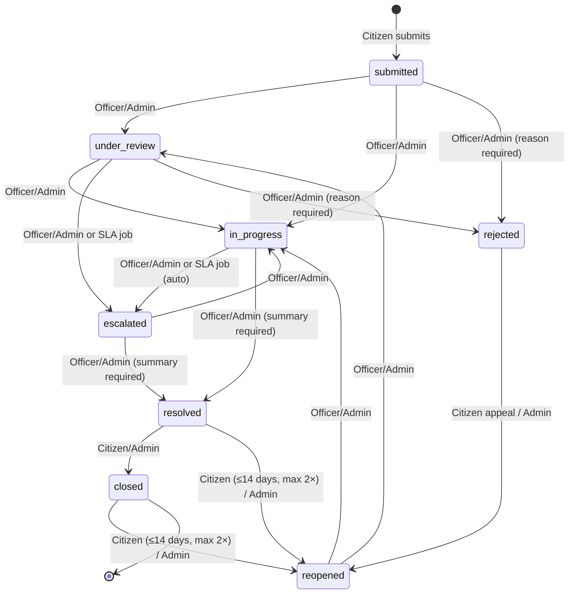
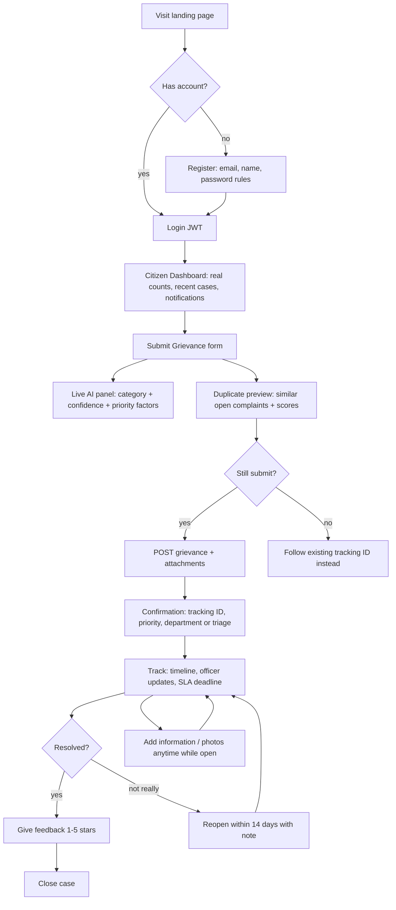
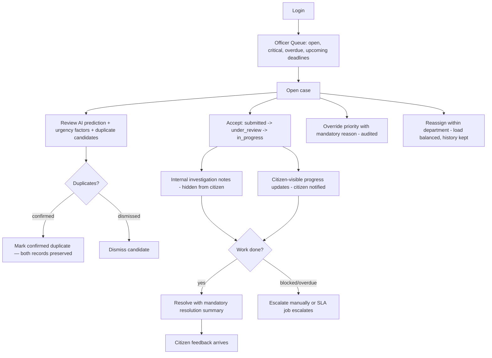
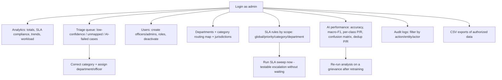
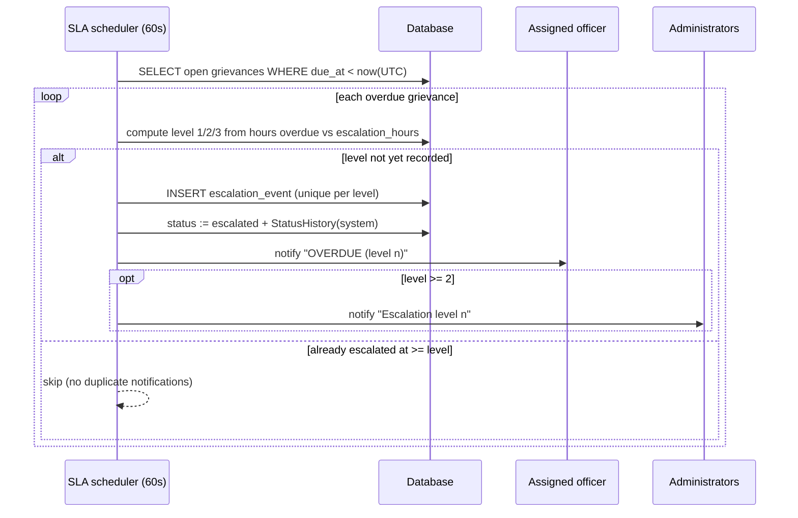

# SmartPetition — User Workflow Diagrams

## 1. Grievance status state machine (backend-enforced)

* Every edge above is defined once in `backend/app/services/state_machine.py` with the
  authorized roles; any other transition returns **409** with a precise reason.
* The SLA background job performs `open → escalated` automatically at level thresholds.
* `rejected` and `resolved` require documented reasons/summaries (enforced server-side).

## 2. Citizen workflow

## 3. Officer workflow

## 4. Administrator workflow

## 5. Automated SLA & escalation sequence

